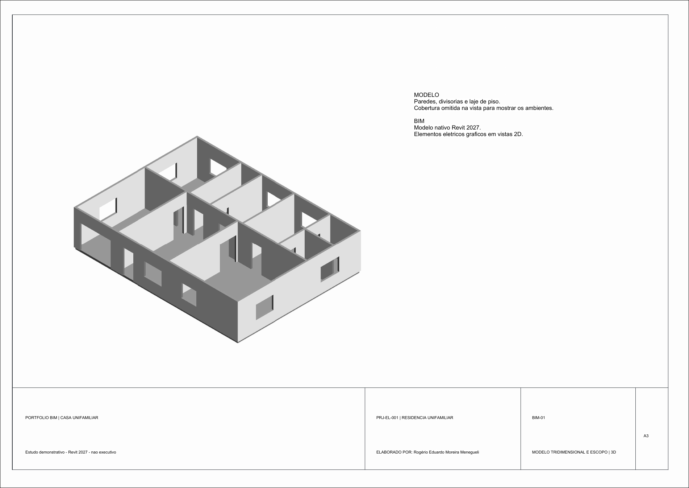
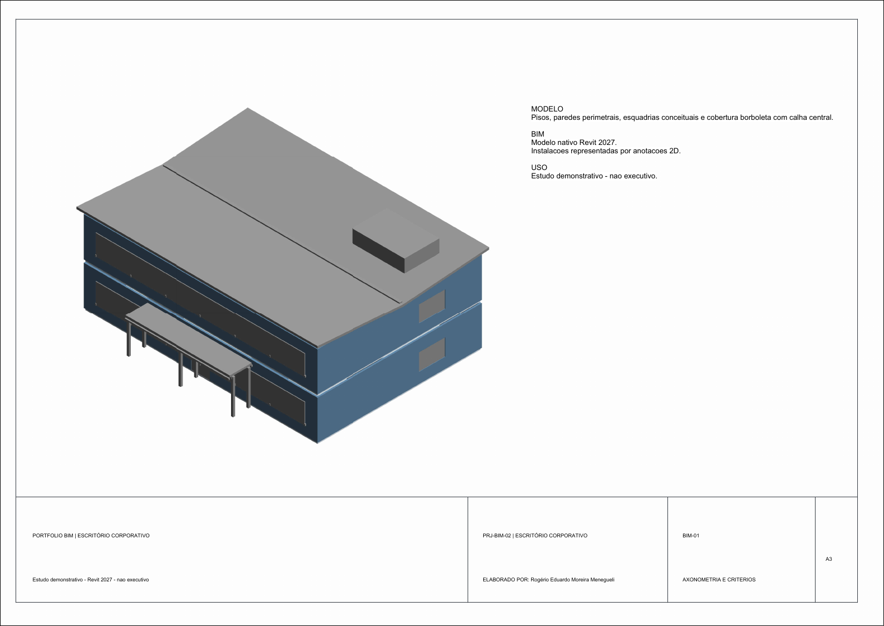
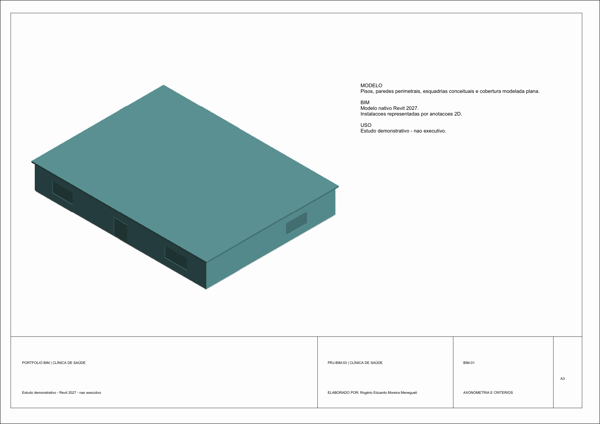
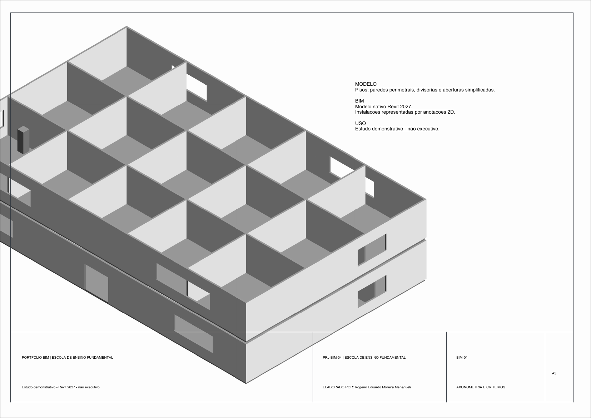
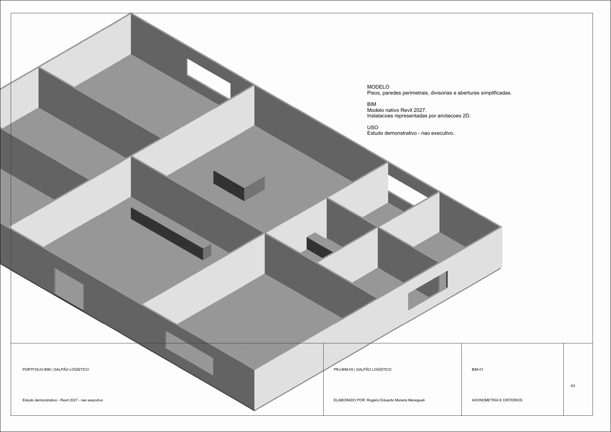

# Portfólio BIM — Instalações elétricas e MEP

Coleção de estudos independentes em Autodesk Revit 2027 para demonstrar modelagem BIM, organização de vistas e documentação de instalações. Cada projeto é publicado em pasta própria, com modelo nativo, pranchas e escopo documentado.

**Progresso: 5 de 14 projetos publicados.**

## Projetos

| Nº | Projeto | Situação |
|---:|---|---|
| 01 | Casa unifamiliar | [Publicado](projetos/01-casa-unifamiliar/README.md) |
| 02 | Escritório corporativo | [Publicado](projetos/02-escritorio-corporativo/README.md) |
| 03 | Clínica de saúde | [Publicado](projetos/03-clinica-de-saude/README.md) |
| 04 | Escola de ensino fundamental | [Publicado](projetos/04-escola-ensino-fundamental/README.md) |
| 05 | Galpão logístico | [Publicado](projetos/05-galpao-logistico/README.md) |
| 06 | Oficina de manutenção industrial | Planejado |
| 07 | Supermercado e varejo | Planejado |
| 08 | Hotel urbano | Planejado |
| 09 | Data center | Planejado |
| 10 | Estacionamento coberto com recarga de veículos elétricos | Planejado |
| 11 | Usina fotovoltaica | Planejado |
| 12 | Subestação e centro de controle de motores | Planejado |
| 13 | Estação de tratamento de água | Planejado |
| 14 | Microrrede com geração solar, baterias e gerador de apoio | Planejado |

## Projetos publicados

### 01 — Casa unifamiliar

Estudo residencial de um pavimento com plantas elétricas esquemáticas, diagrama unifilar, vista 3D e quatro pranchas A3.

- [Modelo Revit (.RVT)](projetos/01-casa-unifamiliar/revit/01-casa-unifamiliar-eletrica.rvt)
- [Pranchas A3 (.PDF)](projetos/01-casa-unifamiliar/pranchas/01-casa-unifamiliar-eletrica.pdf)
- [Premissas do estudo](projetos/01-casa-unifamiliar/dados/premissas-do-estudo.md)

### 02 — Escritório corporativo

Edifício conceitual de dois pavimentos, com áreas de recepção, reunião, operação, foco e colaboração. Inclui plantas arquitetônicas, instalações esquemáticas de iluminação e força/dados, diagrama funcional e axonometria em seis folhas A3.

- [Modelo Revit (.RVT)](projetos/02-escritorio-corporativo/revit/02-escritorio-corporativo.rvt)
- [Seis pranchas A3 (.PDF)](projetos/02-escritorio-corporativo/pranchas/02-escritorio-corporativo.pdf)
- [Mapa de zonas e pontos (.CSV)](projetos/02-escritorio-corporativo/dados/zonas-e-pontos.csv)
- [Premissas e limites do estudo](projetos/02-escritorio-corporativo/dados/premissas-do-estudo.md)

### 03 — Clínica de saúde

Clínica com recepção, triagem, consultórios, exames, imagem, laboratório, farmácia e apoio clínico; estudo de um pavimento, 24 × 18 m.

- [Projeto completo e prévias das seis folhas A3](projetos/03-clinica-de-saude/README.md)
- [Modelo Revit (.RVT)](projetos/03-clinica-de-saude/revit/03-clinica-de-saude.rvt)
- [Pranchas A3 (.PDF)](projetos/03-clinica-de-saude/pranchas/03-clinica-de-saude.pdf)

### 04 — Escola de ensino fundamental

Escola com salas de aula, biblioteca, laboratório, administração, refeitório, pátio e áreas de apoio; dois pavimentos, 30 × 18 m.

- [Projeto completo e prévias das seis folhas A3](projetos/04-escola-ensino-fundamental/README.md)
- [Modelo Revit (.RVT)](projetos/04-escola-ensino-fundamental/revit/04-escola-ensino-fundamental.rvt)
- [Pranchas A3 (.PDF)](projetos/04-escola-ensino-fundamental/pranchas/04-escola-ensino-fundamental.pdf)

### 05 — Galpão logístico

Galpão para recebimento, armazenagem, separação, expedição, docas, administração e apoio; um pavimento, 36 × 24 m.

- [Projeto completo e prévias das seis folhas A3](projetos/05-galpao-logistico/README.md)
- [Modelo Revit (.RVT)](projetos/05-galpao-logistico/revit/05-galpao-logistico.rvt)
- [Pranchas A3 (.PDF)](projetos/05-galpao-logistico/pranchas/05-galpao-logistico.pdf)

## Escopo e uso

Os arquivos descrevem o que foi modelado em cada estudo. Elementos ou rotas elétricas esquemáticas não significam sistemas MEP conectados, cálculos de engenharia, conformidade normativa ou liberação para construção. Consulte as premissas de cada projeto antes de reutilizar seus desenhos ou dados.

## Materiais anteriores no repositório

- [Modelo FreeCAD de subestação, QGBT, CCM e gerador](models_3d/Subestacao_QGBT_CCM_Gerador_BIM_MEP.FCStd)
- [Planilha de quantitativos elétricos](qto_schedules/BIM_Electrical_QTO_LOD350.csv)
- [Script de geração do modelo BIM MEP](scripts/generate_bim_mep_model.py)
- [Prancha de referência existente](docs/preview_board.png)
