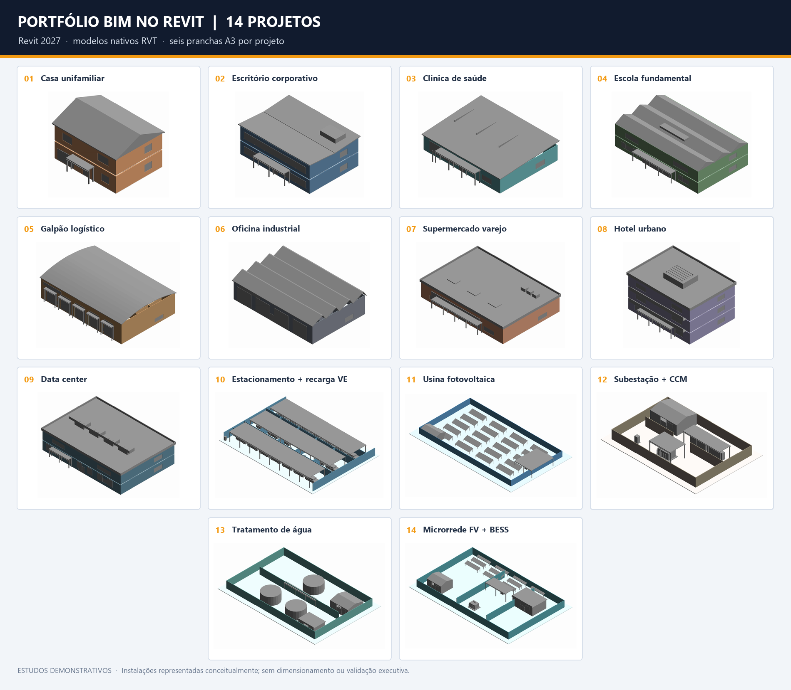

# Portfólio BIM no Revit — instalações elétricas

Este repositório reúne os **14 projetos originais** e o Projeto 19, um estudo BIM conceitual de subestação GIS no Revit 2027. São **15 projetos no total** nesta etapa. Os 14 projetos originais têm seis pranchas A3 cada. A revisão R11 do Projeto 19 foi gerada e auditada no Revit, com modelo, PDF de 14 páginas A3, quatro vistas 3D, PNGs, cálculos, grafo de conectividade e relatório comparativo. O estudo permanece parcial e não atende a LOD 300 ou a projeto executivo.

## Projetos

| # | Projeto | Pranchas A3 | Modelo Revit |
|---:|---|---|---|
| 01 | [Casa unifamiliar](projetos/01-casa-unifamiliar/README.md) | [PDF](projetos/01-casa-unifamiliar/pranchas/01-casa-unifamiliar-eletrica.pdf) | [RVT](projetos/01-casa-unifamiliar/revit/01-casa-unifamiliar-eletrica.rvt) |
| 02 | [Escritório corporativo](projetos/02-escritorio-corporativo/README.md) | [PDF](projetos/02-escritorio-corporativo/pranchas/02-escritorio-corporativo.pdf) | [RVT](projetos/02-escritorio-corporativo/revit/02-escritorio-corporativo.rvt) |
| 03 | [Clínica de saúde](projetos/03-clinica-de-saude/README.md) | [PDF](projetos/03-clinica-de-saude/pranchas/03-clinica-de-saude.pdf) | [RVT](projetos/03-clinica-de-saude/revit/03-clinica-de-saude.rvt) |
| 04 | [Escola de ensino fundamental](projetos/04-escola-ensino-fundamental/README.md) | [PDF](projetos/04-escola-ensino-fundamental/pranchas/04-escola-ensino-fundamental.pdf) | [RVT](projetos/04-escola-ensino-fundamental/revit/04-escola-ensino-fundamental.rvt) |
| 05 | [Galpão logístico](projetos/05-galpao-logistico/README.md) | [PDF](projetos/05-galpao-logistico/pranchas/05-galpao-logistico.pdf) | [RVT](projetos/05-galpao-logistico/revit/05-galpao-logistico.rvt) |
| 06 | [Oficina de manutenção industrial](projetos/06-oficina-manutencao-industrial/README.md) | [PDF](projetos/06-oficina-manutencao-industrial/pranchas/06-oficina-manutencao-industrial.pdf) | [RVT](projetos/06-oficina-manutencao-industrial/revit/06-oficina-manutencao-industrial.rvt) |
| 07 | [Supermercado e varejo](projetos/07-supermercado-varejo/README.md) | [PDF](projetos/07-supermercado-varejo/pranchas/07-supermercado-varejo.pdf) | [RVT](projetos/07-supermercado-varejo/revit/07-supermercado-varejo.rvt) |
| 08 | [Hotel urbano](projetos/08-hotel-urbano/README.md) | [PDF](projetos/08-hotel-urbano/pranchas/08-hotel-urbano.pdf) | [RVT](projetos/08-hotel-urbano/revit/08-hotel-urbano.rvt) |
| 09 | [Data center](projetos/09-data-center/README.md) | [PDF](projetos/09-data-center/pranchas/09-data-center.pdf) | [RVT](projetos/09-data-center/revit/09-data-center.rvt) |
| 10 | [Estacionamento com recarga de veículos elétricos](projetos/10-estacionamento-carga-eletrica/README.md) | [PDF](projetos/10-estacionamento-carga-eletrica/pranchas/10-estacionamento-carga-eletrica.pdf) | [RVT](projetos/10-estacionamento-carga-eletrica/revit/10-estacionamento-carga-eletrica.rvt) |
| 11 | [Usina fotovoltaica](projetos/11-usina-fotovoltaica/README.md) | [PDF](projetos/11-usina-fotovoltaica/pranchas/11-usina-fotovoltaica.pdf) | [RVT](projetos/11-usina-fotovoltaica/revit/11-usina-fotovoltaica.rvt) |
| 12 | [Subestação e centro de controle de motores](projetos/12-subestacao-e-ccm/README.md) | [PDF](projetos/12-subestacao-e-ccm/pranchas/12-subestacao-e-ccm.pdf) | [RVT](projetos/12-subestacao-e-ccm/revit/12-subestacao-e-ccm.rvt) |
| 13 | [Estação de tratamento de água](projetos/13-estacao-tratamento-agua/README.md) | [PDF](projetos/13-estacao-tratamento-agua/pranchas/13-estacao-tratamento-agua.pdf) | [RVT](projetos/13-estacao-tratamento-agua/revit/13-estacao-tratamento-agua.rvt) |
| 14 | [Microrrede solar com BESS e gerador](projetos/14-microrede-fv-bess-gerador/README.md) | [PDF](projetos/14-microrede-fv-bess-gerador/pranchas/14-microrede-fv-bess-gerador.pdf) | [RVT](projetos/14-microrede-fv-bess-gerador/revit/14-microrede-fv-bess-gerador.rvt) |
| 19 | [Subestação GIS 138/13,8 kV — estudo parcial R11](projetos/19-subestacao-gis/README.md) | [PDF A3 — 14 páginas](projetos/19-subestacao-gis/pranchas/reconstrucao-r11/19-subestacao-gis-r11.pdf) · [PNGs](projetos/19-subestacao-gis/pranchas/reconstrucao-r11/README.md) | [RVT R11](projetos/19-subestacao-gis/revit/reconstrucao-r11/19-subestacao-gis-r11.rvt) |

## Conteúdo das pranchas

Nos projetos originais, cada PDF apresenta a planta principal, os pontos esquemáticos de iluminação e força/dados, um diagrama funcional e uma vista axonométrica. O Projeto 19 possui 14 páginas A3 e quatro vistas 3D na revisão R11. Consulte as [imagens PNG por folha](projetos/19-subestacao-gis/pranchas/reconstrucao-r11/README.md), a [auditoria de conectividade](projetos/19-subestacao-gis/dados/reconstrucao-r11/conectividade-r11.md) e o [comparativo R8/R11](projetos/19-subestacao-gis/dados/reconstrucao-r11/comparativo-r8-r11.md). O baseline R8 permanece preservado.

## Escopo e limites

Os modelos e diagramas são estudos conceituais para portfólio e não devem ser usados para obra, compra, aprovação ou instalação. Nos 14 projetos originais, os pontos elétricos são anotações 2D e não formam circuitos MEP conectados. No R11 do Projeto 19, a auditoria encontra 3 conectores MEP (2 conectados), um ElectricalSystem auxiliar QAC-01–UPS-01, um fio 2D específico da vista, 8 segmentos CableTray nativos e 84 elementos DirectShape geométricos. Não há condutor primário de potência nem cabo 3D conectado: rotas e bandejas são geometria/infraestrutura, e as relações de potência restantes estão no diagrama. Permanecem pendentes dados de fonte, proteção, cabos, aterramento, fabricantes e construção civil. Nenhum projeto constitui dimensionamento executivo, certificação normativa, coordenação multidisciplinar ou detecção completa de interferências.

## Ferramentas e validação

O R11 foi gerado e reaberto no Autodesk Revit 2027.3 por add-in C# da Revit API compilado com .NET SDK 10.0.100; o extrator registrou 170 instâncias, 14 folhas, 4 vistas 3D e zero avisos do documento. Os cálculos e o grafo foram executados em Python; 41 testes automatizados passaram. O build do add-in teve zero erros e três avisos MSB3277. O [relatório comparativo e de validação R8/R11](projetos/19-subestacao-gis/dados/reconstrucao-r11/comparativo-r8-r11.md) registra evidências e limitações. O arquivo R8 e seus relatórios históricos continuam preservados.

O RVT R11 tem aproximadamente 8,70 MB e o PDF 1,20 MB; cada família RFA tem menos de 0,5 MB. Nenhum desses arquivos chega ao aviso de 50 MiB ou ao limite rígido de 100 MiB do GitHub, então permanecem no Git comum. O Git LFS não foi necessário; ele usa cotas de armazenamento e transferência. [Limites de arquivo do GitHub](https://docs.github.com/en/repositories/working-with-files/managing-large-files/about-large-files-on-github) · [Cotas de Git LFS](https://docs.github.com/en/billing/concepts/product-billing/git-lfs)

## Estudo volumétrico complementar em FreeCAD

O estudo separado representa cinco equipamentos e uma bandeja de cabos como caixas geométricas de referência.

- [Modelo nativo (.FCStd)](models_3d/Subestacao_QGBT_CCM_Gerador_BIM_MEP.FCStd)
- [Tabela de volumes de referência (.CSV)](dados/estudo-volumetrico-freecad.csv)
- [Script gerador](scripts/generate_bim_mep_model.py)

Os volumes correspondem às caixas simplificadas. Não constituem um modelo BIM coordenado, um quantitativo de obra ou um modelo LOD350.
