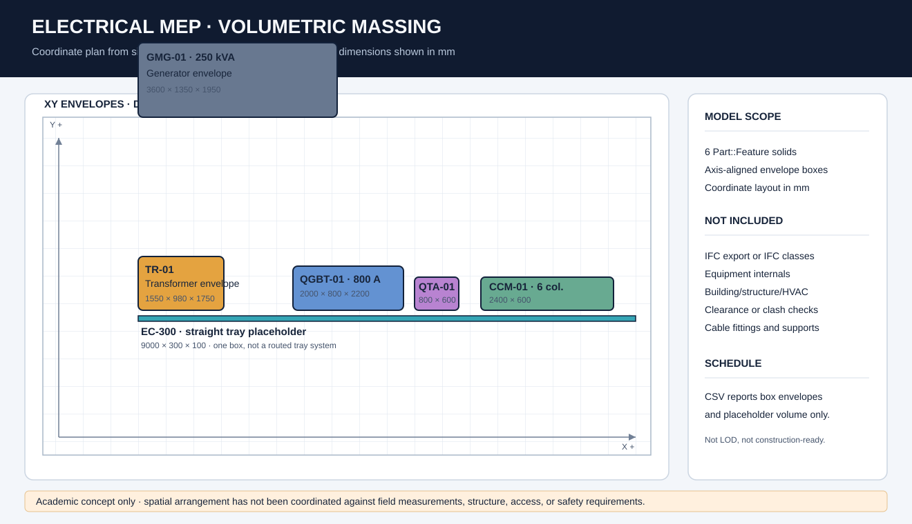

# Subestação MEP — modelo volumétrico conceitual

Este repositório contém um estudo de arranjo espacial de equipamentos elétricos em
FreeCAD. A geometria atual usa seis sólidos `Part::Feature` em formato de caixa para
representar envelopes aproximados. O objetivo é mostrar organização em coordenadas,
não entregar um modelo BIM coordenado.



## O que o modelo contém

- envelopes de transformador, QGBT, QTA, CCM, grupo gerador e um trecho reto de eletrocalha;
- tamanhos nominais e posições em milímetros no script de geração;
- uma tabela CSV com quantidades unitárias e o volume matemático desses prismas.

Os valores do QGBT e do transformador foram alinhados ao estudo conceitual P11 do
[portfólio CAD](https://github.com/r-menegueli/portfolio-autocad-engenharia-eletrica):
800 A e imerso em óleo.

## Fora do escopo

Este modelo não contém objetos IFC, exportação IFC, elementos de edifício, estrutura,
HVAC, instalações detalhadas, suportes de eletrocalha, zonas de manutenção, detecção
de interferências, validação dimensional em FreeCAD, ou verificação de segurança.
As caixas não têm fidelidade para fabricação nem representam objetos em LOD 350. A
tabela é uma contagem dos volumes placeholder e não um quantitativo executivo.

## Arquivos

- `models_3d/Subestacao_QGBT_CCM_Gerador_BIM_MEP.FCStd` — documento FreeCAD com seis volumes conceituais. Os rótulos internos foram alinhados à fonte; a geometria herdada não foi reaberta no FreeCAD durante esta revisão.
- `scripts/generate_bim_mep_model.py` — fonte portátil para reconstruir o documento e `qto_schedules/volumetric_placeholders.csv` dentro de um ambiente que tenha FreeCAD.
- `scripts/update_native_labels.py` — atualiza apenas os identificadores no arquivo FCStd existente, sem alterar a geometria.
- `docs/volumetric-massing.svg` — desenho vetorial do arranjo e dos limites do estudo.
- `qto_schedules/volumetric_placeholders.csv` — dimensões e volumes dos seis prismas.

Para reconstruir o modelo, execute o script pelo console Python do FreeCAD:

```text
exec(open("scripts/generate_bim_mep_model.py", encoding="utf-8").read())
```

O resultado continua sendo um estudo acadêmico de massa. Antes de qualquer uso real,
é necessário modelar os componentes, medir o local, coordenar as disciplinas e
validar folgas, acessos, rotas e requisitos técnicos com profissionais habilitados.
