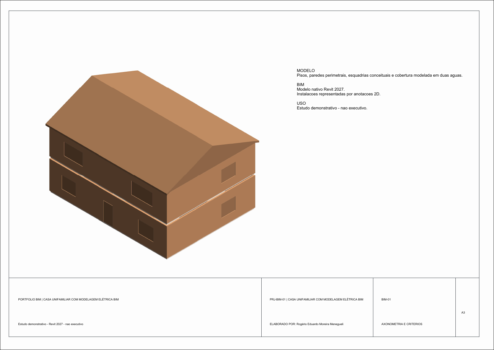

# Projeto 01 — Casa unifamiliar

Estudo demonstrativo de modelagem no Revit 2027, com dois pavimentos, garagem, sala integrada, cozinha, área de serviço, escritório, suítes e circulação familiar.

## Escopo modelado

- Envelope de referência: 14,00 × 10,50 m por pavimento.
- Pisos, paredes, aberturas conceituais e cobertura em duas águas.
- Pontos de iluminação e força/dados apresentados como anotações 2D.
- Diagrama funcional para representar a organização elétrica conceitual.

## Entregáveis

- [Modelo nativo Revit (.RVT)](revit/01-casa-unifamiliar-eletrica.rvt)
- [Seis pranchas A3 em PDF](pranchas/01-casa-unifamiliar-eletrica.pdf)
- [Zonas e sistemas (.CSV)](dados/zonas-e-sistemas.csv)
- [Premissas do estudo](dados/premissas-do-estudo.md)
- [Família A3 usada nas folhas (.RFA)](familias/Portfolio_A3.rfa)

## Pranchas

| Folha | Conteúdo |
|---|---|
| A-01 | Planta principal |
| A-02 | Pavimento superior e organização dos ambientes |
| E-01 | Pontos esquemáticos de iluminação |
| E-02 | Pontos esquemáticos de força e dados |
| E-03 | Diagrama funcional |
| BIM-01 | Vista axonométrica e critérios do modelo |

## Limites de uso

As instalações são esquemáticas, sem circuitos MEP conectados, cálculo, dimensionamento ou validação normativa. O estudo não é executivo e não deve ser usado para obra, compra, aprovação ou instalação.