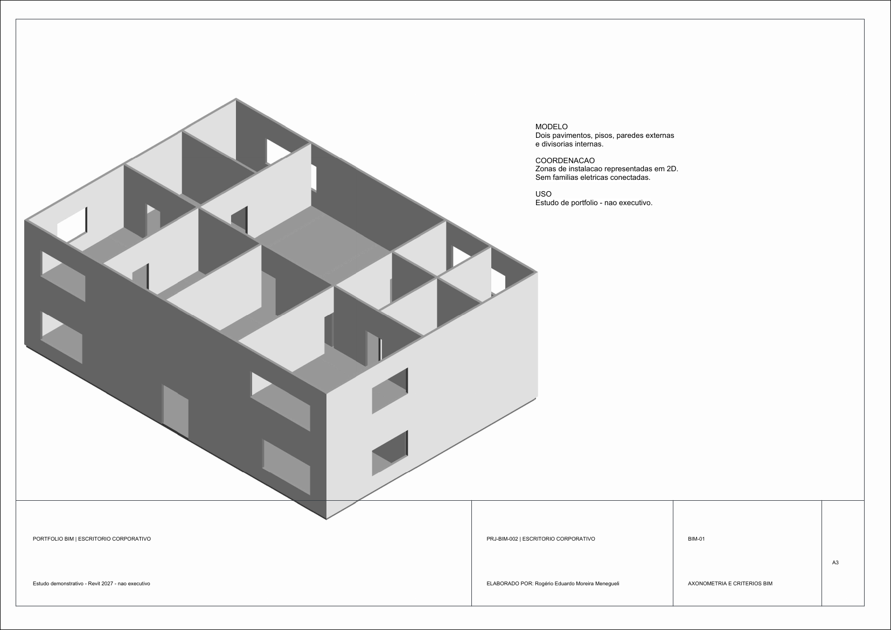

# Projeto 02 — Escritório corporativo

Estudo de modelagem BIM no Revit 2027 para um edifício de dois pavimentos, com programa corporativo e documentação arquitetônica e elétrica esquemática.

## Escopo modelado

- Pavimento de acesso com recepção, atendimento, operação aberta, salas de reunião, TI, copa e apoio.
- Pavimento corporativo com estações flexíveis, salas de foco, colaboração, diretoria e apoio.
- Pisos, paredes externas, divisórias, níveis e aberturas modelados no arquivo nativo do Revit.
- Plantas arquitetônicas dos dois pavimentos, planta esquemática de iluminação, planta de força e dados, diagrama funcional e axonometria.
- Envelope de estudo de 20 × 14 m por pavimento; área geométrica de referência de 280 m² por piso.

## Entregáveis

- [Modelo nativo Revit (.RVT)](revit/02-escritorio-corporativo.rvt)
- [Seis pranchas A3 em PDF](pranchas/02-escritorio-corporativo.pdf)
- [Mapa de zonas e pontos (.CSV)](dados/zonas-e-pontos.csv)
- [Premissas e limites do estudo](dados/premissas-do-estudo.md)
- [Família A3 usada nas folhas (.RFA)](familias/Portfolio_A3.rfa)

## Limites de uso

As instalações são anotações gráficas esquemáticas, sem famílias MEP conectadas ou circuitos calculados pelo Revit. O estudo não verifica acessibilidade, segurança contra incêndio, estrutura, iluminação, demanda, alimentadores, proteções, aterramento ou compatibilização executiva. Não usar para obra, aprovação, compra ou instalação.
