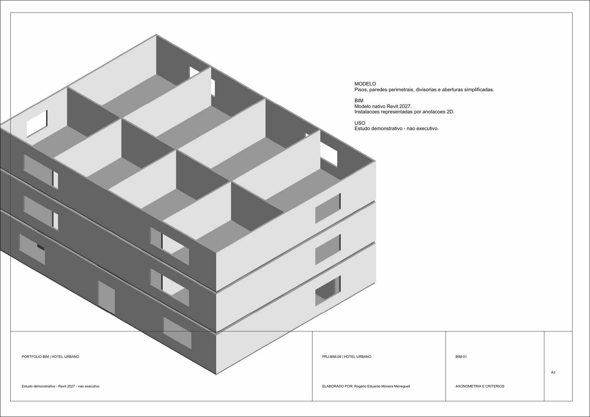

# Projeto 08 — Hotel urbano

Hotel com lobby, recepção, restaurante, cozinha, serviços, quartos, circulação e áreas de apoio.

## Escopo modelado

- Envelope de estudo: 22,00 × 16,00 m por pavimento; 3 pavimentos.
- Modelo Revit nativo com pisos, paredes perimetrais, divisórias e aberturas simplificadas.
- Vistas de arquitetura, iluminação, força e sistemas, diagrama funcional e axonometria.
- Pranchas em formato A3, com identificação, legenda e premissas de estudo.

## Pranchas e prévias

| Folha | Conteúdo | Prévia PNG |
|---|---|---|
| A-01 | Planta arquitetônica / pavimento de acesso | [Abrir prévia](pranchas/preview/A-01-arquitetura.png) |
| A-02 | Pavimento superior / zonas e equipamentos | [Abrir prévia](pranchas/preview/A-02-pavimento-superior.png) |
| E-01 | Iluminação esquemática | [Abrir prévia](pranchas/preview/E-01-iluminacao.png) |
| E-02 | Força e sistemas esquemáticos | [Abrir prévia](pranchas/preview/E-02-forca-sistemas.png) |
| E-03 | Diagrama funcional | [Abrir prévia](pranchas/preview/E-03-diagrama-funcional.png) |
| BIM-01 | Axonometria do modelo | [Abrir prévia](pranchas/preview/BIM-01-axonometria.png) |

## Arquivos entregues

- [Modelo nativo do Revit (.RVT)](revit/08-hotel-urbano.rvt)
- [Conjunto de pranchas A3 (.PDF)](pranchas/08-hotel-urbano.pdf)
- [Zonas e sistemas (.CSV)](dados/zonas-e-sistemas.csv)
- [Premissas, escopo e limitações](dados/premissas-do-estudo.md)
- [Família de margem A3 (.RFA)](familias/Portfolio_A3.rfa)

## Limites de uso

As instalações elétricas e os sistemas estão representados de forma esquemática. O estudo não contém circuitos MEP conectados, dimensionamento, validação normativa ou detalhamento executivo; não deve ser usado para obra, compra, aprovação ou instalação.
