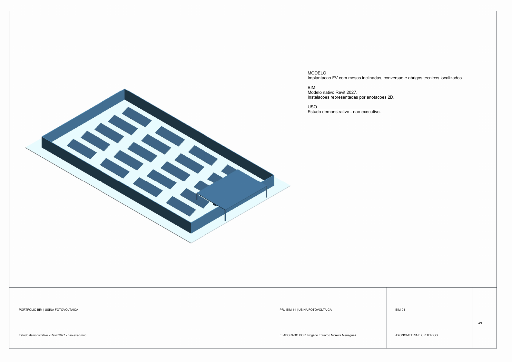

# Projeto 11 — Usina fotovoltaica

Implantação de estudo com mesas fotovoltaicas, inversor, transformador, armazenamento em baterias e gerador de apoio.

## Escopo modelado

- Área de referência: 60,00 × 36,00 m; 1 pavimento.
- Implantação esquemática com zonas funcionais e volumes genéricos para equipamentos; não há envelope edificado.
- Vistas de arquitetura/implantação, iluminação, força e sistemas, diagrama funcional e axonometria.
- Pranchas em formato A3 com identificação, legendas e premissas de estudo.

## Pranchas e prévias

| Folha | Conteúdo | Prévia PNG |
|---|---|---|
| A-01 | Planta arquitetônica / implantação | [Abrir prévia](pranchas/preview/A-01-arquitetura.png) |
| A-02 | Zonas e equipamentos no pavimento de acesso / zonas e equipamentos | [Abrir prévia](pranchas/preview/A-02-pavimento-superior.png) |
| E-01 | Iluminação esquemática | [Abrir prévia](pranchas/preview/E-01-iluminacao.png) |
| E-02 | Força e sistemas esquemáticos | [Abrir prévia](pranchas/preview/E-02-forca-sistemas.png) |
| E-03 | Diagrama funcional | [Abrir prévia](pranchas/preview/E-03-diagrama-funcional.png) |
| BIM-01 | Axonometria do modelo | [Abrir prévia](pranchas/preview/BIM-01-axonometria.png) |

## Arquivos entregues

- [Modelo nativo do Revit (.RVT)](revit/11-usina-fotovoltaica.rvt)
- [Conjunto de pranchas A3 (.PDF)](pranchas/11-usina-fotovoltaica.pdf)
- [Zonas e sistemas (.CSV)](dados/zonas-e-sistemas.csv)
- [Premissas, escopo e limitações](dados/premissas-do-estudo.md)
- [Família de margem A3 (.RFA)](familias/Portfolio_A3.rfa)

## Limites de uso

O modelo é demonstrativo. As instalações e os sistemas são esquemáticos; não foram desenvolvidos circuitos MEP conectados, cálculos, validação normativa ou detalhamento executivo. Não usar para obra, compra, aprovação ou instalação.
