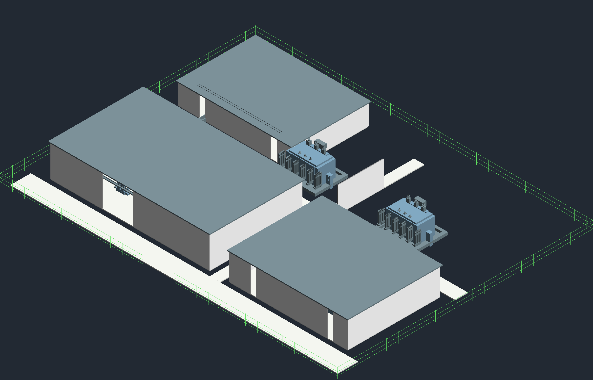

# Projeto 19 — Subestação GIS 138/13,8 kV

**Estado: estudo BIM parcial.** A revisão R8 foi gerada no Revit 2027.3 e documentada para avaliação. Ela demonstra modelagem de famílias, organização de elementos, documentação e cálculos reproduzíveis. Ainda não atende ao nível de desenvolvimento semelhante a LOD 300 pretendido e não é projeto executivo.

## Arquivos R8

- Modelo Revit: [19-subestacao-gis-r8.rvt](revit/reconstrucao-r8/19-subestacao-gis-r8.rvt)
- Pranchas A3: [PDF com 21 páginas](pranchas/reconstrucao-r8/19-subestacao-gis-r8.pdf)
- Imagens PNG das 21 pranchas e vista 3D: [índice das imagens](pranchas/reconstrucao-r8/README.md)
- Biblioteca: [30 arquivos RFA](familias/reconstrucao-r8/)
- Vista geral 3D: 
- Auditoria extraída do RVT: [auditoria-modelo-r8.json](dados/reconstrucao-r8/auditoria-modelo-r8.json)
- [Registro de validação R8](dados/reconstrucao-r8/registro-validacao.md): abertura no Revit, exportações, contagens, testes, avisos do build e limites da conferência visual.
- Quantitativos por instância: [quantitativos-modelo.csv](dados/reconstrucao-r8/quantitativos-modelo.csv)
- Cálculos: [memorial](dados/reconstrucao-r8/memorial-de-calculo.md), [resultados CSV](dados/reconstrucao-r8/resultados.csv) e [resultados JSON](dados/reconstrucao-r8/resultados.json)
- Serviços auxiliares: [entradas R8](dados/servicos-auxiliares-r8.json), [memorial e resultados](dados/reconstrucao-r8/memorial-servicos-auxiliares-r8.md)
- [Revisão crítica técnica, BIM e de apresentação](revisao-critica-profissional.md)
- [Rascunho LinkedIn não publicado](linkedin-proposta.md)

## Evidências verificadas

O log do Revit registra 191 instâncias FamilyInstance: 46 em Electrical Equipment e 145 em Generic Models; 21 paredes e 7 pisos nativos; 180 ModelCurves; zero DirectShapes; 21 folhas e 8 vistas 3D. Foram produzidos 30 arquivos RFA. O CSV documenta identificadores, categorias, sistemas, coordenadas, propriedades e estado geométrico; a auditoria não encontrou instâncias sem os metadados de identidade requeridos.

O arquivo de auditoria registra 93 portas de conectores MEP, zero portas fisicamente conectadas, um sistema elétrico e um elemento terminal. Esse sistema é o circuito lógico auxiliar QAC-01–UPS-01; cabos físicos não foram modelados. A prancha E-06 identifica canaletas e leitos como rotas conceituais. As notas das vistas 3D explicitam essas condições.

O PDF tem 21 páginas A3 (1190,52 × 841,8 pontos). As páginas foram renderizadas em PNG, organizadas no índice e inspecionadas em folhas de contato; a Q-01 foi conferida em alta resolução e sua linha inferior foi reposicionada para não cruzar a última família.

Os testes automatizados dos dois motores Python passaram: 10 testes. Comando: python -m unittest -v tests.test_gis_substation_study tests.test_gis_substation_auxiliary. Isso valida as regras implementadas e suas premissas; não valida dados de campo, fabricante ou concessionária.

## Base elétrica e resultados

A arquitetura de duas entradas em 138 kV, barramento duplo com acoplador, dois transformadores candidatos de 40 MVA e barras A/B de 13,8 kV com tie normalmente aberto é uma hipótese de estudo. As cargas de 56 MW normal, 32 MW críticas, fator de potência 0,95 e impedância provisória de 10% estão identificadas como premissas. O cálculo N-1 mostra que a carga crítica cabe em um transformador de 40 MVA, mas a carga total exige alívio de 24 MW. A potência dos transformadores não foi tratada como capacidade firme somada.

Os scripts implementam cálculo trifásico de correntes, carregamento e contingência, compensação de fator de potência, estimativa simplificada de curto no transformador e estimativas de serviços auxiliares, UPS e bateria. Entradas, métodos, resultados e estados estão nos JSON/CSV/MD de R8.

## Pendências que impedem aprovação executiva ou LOD 300

- Curto-circuito da rede, níveis de falta, fluxo de carga detalhado, seletividade, ajustes e capacidade interruptiva exigem dados de concessionária e de equipamentos.
- Ainda não há cabos físicos ou conexões MEP verificadas entre os equipamentos. A lista de cabos, seções, materiais, métodos de instalação, ocupação, segregação, queda de tensão e suportação não foi dimensionada.
- Os parâmetros de potência e geometria são estimativas. Não foram selecionados fabricantes nem confirmadas placas, desenhos dimensionais, impedâncias, perdas, acessórios e isolação.
- A malha de aterramento é uma grade conceitual de ModelCurves; faltam resistividade, corrente e tempo de falta, tensões de toque/passo e verificação de conformidade.
- As cargas auxiliares, autonomia de bateria/UPS, filosofia de proteção/controle, incêndio, acessibilidade, geotecnia, drenagem e requisitos civis permanecem preliminares ou sem verificação.
- As vistas gerais ainda mostram áreas internas encobertas pelos edifícios e algumas folhas mantêm bastante espaço livre. A correção da Q-01 e as 21 folhas A3 melhoraram a apresentação, mas o padrão visual e informacional de coordenação LOD 300 não foi atingido.

Não usar para obra, compra, aprovação ou instalação. A revisão crítica registra as cinco principais pendências e o que foi resolvido parcialmente. Os outros projetos continuam fora desta revisão.
