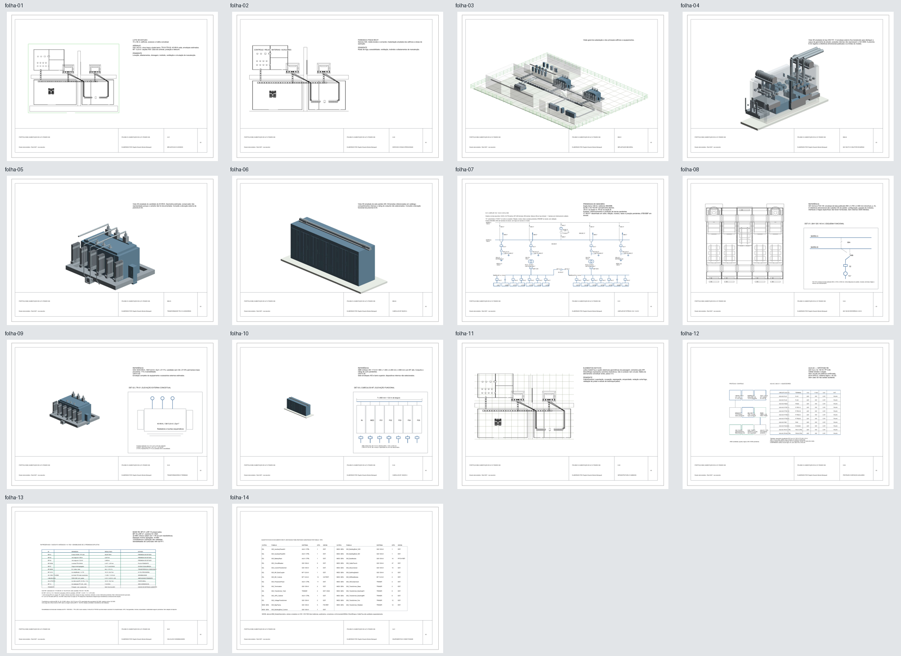

# Projeto 19 — Subestação GIS 138/13,8 kV

## Estado atual — 09/11/2026

**R20-23 é a revisão mais recente, gerada e extraída de um documento aberto no Revit 2027.3.** O [relatório comparativo R8 × R20-23](attempts/r20-23-candidate/dados/reconstrucao-r20/comparativo-r8-r20-23.md) separa as melhorias verificadas das pendências. Os arquivos da candidata isolada estão em [attempts/r20-23-candidate](attempts/r20-23-candidate/): [RVT](attempts/r20-23-candidate/revit/reconstrucao-r20/19-subestacao-gis-r20.rvt), [PDF A3 de 14 folhas](attempts/r20-23-candidate/pranchas/reconstrucao-r20/19-subestacao-gis-r20-23-A3.pdf), [auditoria extraída](attempts/r20-23-candidate/dados/reconstrucao-r20/auditoria-modelo-r20.json), [conectividade por equipamento](attempts/r20-23-candidate/dados/reconstrucao-r20/conectividade-equipamentos-r20.csv) e [relações de rede](attempts/r20-23-candidate/dados/reconstrucao-r20/relacoes-rede-r20.csv).

A auditoria registra 168 instâncias de família, 46 equipamentos, 24 DirectShapes, 8 leitos nativos com 8/16 conectores ligados em juntas de infraestrutura, 25 conectores MEP com 2 ligados no sistema auxiliar QAC-01–UPS-01, 1 fio 2D, 14 folhas, 4 vistas 3D e zero avisos. Os 12 trajetos faseados e as barras GIS são geometria de estudo; a rede primária continua sem condutores ou circuitos nativos conectados.

O PDF A3 foi renderizado e inspecionado em todas as páginas. A exportação PDF nativa do Revit falhou por indisponibilidade local de renderer/bibliotecas de material; a contingência e a normalização de formato estão documentadas no comparativo. O documento abriu e foi auditado pelo Revit, mas o canvas da sessão permaneceu visualmente em branco; as vistas foram inspecionadas nas folhas impressas. R20-23 é um estudo BIM demonstrativo, não documento executivo, aprovação normativa ou prova de dimensionamento. A revisão foi atualizada no branch de trabalho; não houve publicação no LinkedIn nem execução de outros empreendimentos.

O snapshot R20-22 e as revisões anteriores abaixo são históricos e permanecem preservados.

## Histórico de estado — 08/11/2026 (snapshot anterior à geração R20-22)

**A última saída executada e auditada no Revit é a candidata R20-14; a R20-21 ainda não foi executada.** R20-14 contém RVT, PDF de 14 folhas, quantitativos e auditorias, mas permanece parcial: não confirma condutores físicos nem circuitos de potência primária, e sua inspeção visual ainda aponta revisão de E-03/E-04. Consulte o [registro de execução R20-14](attempts/r20-14-candidate/README-R20.md) e a [auditoria visual do PDF](attempts/r20-14-candidate/dados/reconstrucao-r20/auditoria-visual-pdf-r20-14.md).

A R20-21 usa como referência o envelope de baia F35-145 publicado pela GE Vernova: 800 × 3.700 × 2.500 mm. O GA de pedido, a variante comprada, as posições de módulos, terminais e folgas do projeto continuam pendentes. As builds `690E867B…44C2FBAA` e `974A65F1…FA7168F` estão supersedidas e não devem ser carregadas. A build atual está em staging em `scripts/revit-addin/staging-build-r20-f35-envelope-23/PortfolioExpansion.dll` (426.496 bytes; SHA-256 `F435D2BE5B1386AFF3BF2DB24D547F6B033A1DF93BF28B024AF0042A9E0A20B4`), aguardando autorização específica. Ainda não há RVT, PDF ou evidência visual R20-21. Veja a [referência R21](dados/reconstrucao-r21/referencias-equipamentos-r21.json), a [retificação dimensional](dados/reconstrucao-r20/errata-referencia-f35.md) e o [estado da build](../../scripts/revit-addin/README.md).

A especificação do grafo complementar agora segue o E-01 atual: CT-BC01* fica em série entre 52-BC e 89B, sem ser classificado como circuito nativo. O teste verifica essa sequência e a ausência do bypass direto 52-BC→89B. O grafo extraído de R20-14 permanece histórico; a nova sequência ainda precisa de extração após a execução R20-21.

Os quantitativos históricos R20-12, R20-13 e R20-14 permanecem sem edição; suas erratas anteriores foram retificadas após conferir a tabela “Bay Dimensions” na brochura oficial: [R20-12](attempts/r20-12-candidate/dados/reconstrucao-r20/errata-referencia-f35.md), [R20-13](attempts/r20-13-candidate/dados/reconstrucao-r20/errata-referencia-f35.md) e [R20-14](attempts/r20-14-candidate/dados/reconstrucao-r20/errata-referencia-f35-r20-14.md).

As seções abaixo registram a entrega R11 como histórico. Nenhuma revisão deste projeto comprova documentação executiva, aprovação normativa ou LOD 300.

**Histórico R11:** estudo BIM parcial gerado e auditado no Revit 2027.3. A revisão documenta topologia, detalha externamente um bay GIS, um transformador e uma seção MT, e distingue conexões nativas, geometria de infraestrutura e relações existentes apenas no diagrama.

## Entrega R11

- Modelo: [19-subestacao-gis-r11.rvt](revit/reconstrucao-r11/19-subestacao-gis-r11.rvt)
- Pranchas: [PDF A3 com 14 folhas](pranchas/reconstrucao-r11/19-subestacao-gis-r11.pdf)
- PNGs das 14 folhas e das quatro vistas 3D: [índice de imagens](pranchas/reconstrucao-r11/README.md)
- Biblioteca Revit: [30 famílias RFA](familias/reconstrucao-r11/)
- Auditoria extraída do modelo: [JSON](dados/reconstrucao-r11/auditoria-modelo-r11.json) e [quantitativos CSV](dados/reconstrucao-r11/quantitativos-modelo.csv)
- Conectividade por equipamento: [CSV de conectores e estados](dados/reconstrucao-r11/conectividade-equipamentos-r11.csv)
- Relações de rede e rastreabilidade: [CSV](dados/reconstrucao-r11/relacoes-rede-r11.csv), [grafo JSON](dados/reconstrucao-r11/grafo-conectividade-r11.json) e [relatório](dados/reconstrucao-r11/conectividade-r11.md)
- Cálculos preservados e sensibilidades adicionais: [entradas/resultados JSON](dados/reconstrucao-r11/estudo-complementar-r11.json), [CSV](dados/reconstrucao-r11/estudo-complementar-r11.csv) e [memorial](dados/reconstrucao-r11/memorial-complementar-r11.md)
- Comparação, validação e pendências: [R8 versus R11](dados/reconstrucao-r11/comparativo-r8-r11.md)
- Vista geral: 

## Auditoria Revit R11

O relatório foi extraído por add-in de um documento Revit aberto e registra 170 instâncias FamilyInstance (46 equipamentos elétricos e 124 modelos genéricos), 21 paredes, 7 pisos, 84 DirectShapes, 175 ModelCurves, 8 elementos CableTray nativos, 14 folhas, 4 vistas 3D e zero avisos do documento. As 30 famílias foram geradas ou reutilizadas no diretório R11; todas as instâncias têm os metadados de identidade exigidos.

Há 3 conectores MEP auditados, dos quais 2 aparecem conectados; 44 dos 46 equipamentos não têm conector MEP. O único ElectricalSystem associa QAC-01 a UPS-01 e tem um terminal. Um fio nativo 2D, específico da vista E-06, tem seus dois conectores ligados. **Isso não representa cabo 3D, circuito de potência primária ou alimentação completa da UPS.**

O grafo contém 62 nós e 58 relações: 14 `GEOMETRIC_ROUTE_ONLY`, 43 `DIAGRAM_ONLY` e 1 `NATIVE_ELECTRICAL_SYSTEM_LOGICAL`. Não há condutor primário de potência confirmado. Oito segmentos CableTray têm 16 conectores e 8 conectores com estado conectado; essas ligações comprovam juntas de infraestrutura, não continuidade elétrica. Os dois pontos de entrada externos e dez destinos remotos dos alimentadores estão fora do modelo.

## Unifilar, geometria e referências

A E-01 representa duas barras de 138 kV com acoplador, bays para duas linhas e dois transformadores, seletores de barra e duas seções de 13,8 kV com tie normalmente aberto. Os estados de manobra são hipóteses explicitadas na prancha; contatos e intertravamentos não são simulados no Revit.

O bay GIS R11 é um estudo de classe 145 kV. A página impressa 6 da brochura F35-145 lista o envelope de baia 800 × 3.700 × 2.500 mm. Isso fornece uma referência dimensional de produto, mas não valida a variante comprada, o GA do pedido, posições de módulos, terminais ou folgas do arranjo R11. Para o transformador foi consultado o [catálogo DAX 138/13,8 kV, 30/40 MVA](https://dax.energy/produtos/transformadores-de-potencia); para os cubículos, a família [ABB UniGear ZS1 17,5 kV](https://www.abb.com/global/en/areas/electrification/medium-voltage/switchgear/air-insulated/unigear/zs1); e para o cabo candidato, a ficha [Nexans EPR105-PVC 8,7/15 kV, 1×240 mm²](https://www.nexans.com.br/pt/products/Transmission.and.Distribution/Insulated.Copper-Aluminium.CablesForMediumVoltage/Nexans-EPR105-PVC/Nexans-EPR37761/product~ID540477955~.html). São referências para estudo, não equipamentos selecionados nem desenhos GA de fabricação.

As rotas HV/MV e stubs de seccionadoras são geometria representativa sem conectores elétricos. CableTrays são infraestrutura nativa. Não foram inventados internos proprietários de GIS, transformador ou cubículos.

## Cálculos e limites

Os 25 IDs de cálculo R8 permanecem registrados em R11. Nas hipóteses de 56 MW e FP 0,95, S é 58,95 MVA; as correntes trifásicas são 0,2466 kA em 138 kV e 2,466 kA em 13,8 kV. Dois transformadores de 40 MVA resultam em 73,68% de carregamento agregado; em N−1, 32 MW críticos correspondem a 84,21% de uma unidade, enquanto 56 MW totais excedem sua capacidade e exigem 24 MW de alívio.

A sensibilidade de cabo para 6 MW, FP 0,95, 13,8 kV e 250 m apresenta 264,23 A, queda de 13,99 V (0,101%) e perdas de cobre trifásicas de 5,02 kW para um candidato de cobre 1×240 mm². A ampacidade não foi verificada; X=0,1 Ω/km é hipótese. Curto-circuito adicional combina fonte, impedância provisória de transformador de 10% e trecho de cabo: com fonte assumida de 1.000 MVA e 250 m, o resultado simétrico é 11,95/11,51 kA (barra/remoto) com uma unidade e 18,59/17,54 kA com duas em paralelo. Esses cenários não definem capacidade de interrupção, proteção ou seletividade.

Permanecem pendentes dados da concessionária, placas e impedâncias aprovadas, ampacidade e instalação dos cabos, materiais e terminações, aterramento por resistividade e tempo de falta, missão DC/UPS, ajustes e seletividade, estados e intertravamentos, afastamentos, rotas civis e desenhos dimensionais dos fabricantes. Não usar para obra, compra, aprovação ou instalação.

## Histórico R8 preservado

O baseline anterior permanece disponível sem sobrescrita: [RVT R8](revit/reconstrucao-r8/19-subestacao-gis-r8.rvt), [PDF R8 com 21 folhas](pranchas/reconstrucao-r8/19-subestacao-gis-r8.pdf), [auditoria](dados/reconstrucao-r8/auditoria-modelo-r8.json), [cálculos](dados/reconstrucao-r8/resultados.json) e [índice de imagens](pranchas/reconstrucao-r8/README.md). A comparação inclui os números R8 e R11 lado a lado.
