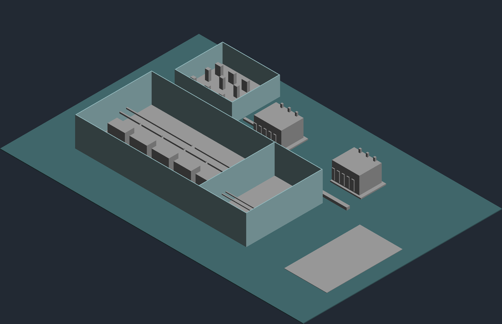

# Projeto 19 — Subestação de alta tensão GIS

Estudo BIM conceitual para uma subestação 138/13,8 kV, com cálculo elétrico preliminar reproduzível.

## Escopo e modelo

- Implantação de 64 x 42 m.
- Edifício GIS com separação indicativa para cubículos de 13,8 kV.
- Cinco bays GIS conceituais, dois transformadores 25 MVA, cubículos MT, casa de controle, painéis de proteção/automação e rotas de canaletas.
- Paredes do edifício são elementos Wall nativos do Revit. Equipamentos são DirectShape em categorias técnicas com marca e comentários de estudo; não são famílias paramétricas de fabricante e não têm conectores ou circuitos funcionais.
- O unifilar, a proteção/controle e os diagramas são documentação esquemática em vistas Drafting do Revit.

## Cálculos

Entradas, fórmulas, resultados e limites estão em [dados](dados/). O script Python implementa carga aparente/reativa, correntes trifásicas, carregamento, contingência N-1, compensação de FP e uma estimativa simplificada de curto no secundário. Não há estudo de curto da rede, seleção de disjuntores, coordenação, cabos, aterramento ou perdas de fabricante.

## Arquivos

- [Modelo nativo Revit (.RVT)](revit/19-subestacao-gis.rvt)
- [Pranchas A3 (.PDF)](pranchas/19-subestacao-gis.pdf)
- [Memorial de cálculo](dados/memorial-de-calculo.md)
- [Resultados JSON](dados/resultados.json)
- [Quantitativos extraídos dos DirectShapes](dados/quantitativos-modelo.csv)
- [Prévias PNG das pranchas](pranchas/preview/)
- [Vista 3D exportada do Revit](pranchas/preview/19-subestacao-gis-3d.png)
- [Premissas e limites](dados/premissas-do-estudo.md)

## Estado de validação

Validado no Revit 2027.3: o RVT foi aberto, a vista 3D axonométrica foi conferida, oito folhas A3 foram exportadas e renderizadas, e cinco testes dos cálculos passaram. A prancha de cálculos e o memorial registram premissas, estimativas e limites do estudo.

